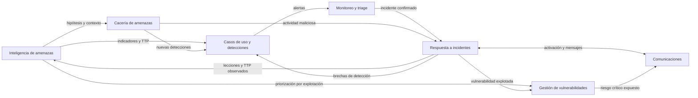

# Digest de conocimiento: blue-ir

- **CIAC-004 Caceria de amenazas** — `contrib/ciac-knowledge/cache/threat-hunting/README.md` (sha256 d36ad04b47f5)
- **CIAC-005 Respuesta a incidentes** — `contrib/ciac-knowledge/cache/incident-response/README.md` (sha256 f17063a3a9bd)
- **CIAC-006 Laboratorios DFIR** — `contrib/ciac-knowledge/cache/dfir-labs/README.md` (sha256 a7ef49df305f)
- **CIAC-007 Procedimientos operativos** — `contrib/ciac-knowledge/cache/standard-operating-procedures/README.md` (sha256 f6d3515191db)
- **CIAC-010 Plantilla de informe** — `contrib/ciac-knowledge/cache/templates/incident-report.md` (sha256 92ffffe779ef)
- **CIAC-011 Datasets sinteticos** — `contrib/ciac-knowledge/cache/datasets/README.md` (sha256 4bc2511fc9ea)

## README.md
# Cacería de amenazas (Threat Hunting)

Búsqueda proactiva de actividad maliciosa que evadió los controles existentes, con el objetivo de **reducir el tiempo de permanencia del atacante** (*dwell time*) y mejorar continuamente la detección.

## Estructura

```
threat-hunting/
├── frameworks/          ← metodologías de referencia explicadas en español
│   ├── tahiti.md          TaHiTI: cacería dirigida por inteligencia
│   ├── magma.md           MaGMa: gestión de casos de uso de detección
│   └── peak.md            PEAK: hipótesis, línea base y modelos
├── hunts/               ← cacerías documentadas por la comunidad
│   └── _plantilla-hunt.md
└── backlog.md           ← ideas de cacería abiertas para que alguien las tome
```

## ¿Qué framework uso?

| Framework | Origen | Enfoque | Ideal para |
|---|---|---|---|
| [TaHiTI](frameworks/tahiti.md) | FI-ISAC Países Bajos (sector financiero), 2018 | Cacería estructurada disparada y enriquecida por inteligencia de amenazas | Equipos con función CTI y sectores regulados (banca, energía, gobierno) |
| [MaGMa](frameworks/magma.md) | FI-ISAC Países Bajos, 2017 | Gestión de casos de uso de monitoreo: de los riesgos del negocio a las reglas | Saber **qué ya se detecta** para no cazar lo que el SIEM ya cubre, y medir cobertura |
| [PEAK](frameworks/peak.md) | Splunk SURGe, 2023 | Tres tipos de cacería: por hipótesis, por línea base y asistida por modelos | Equipos que quieren combinar hipótesis con análisis de datos y anomalías |

Se complementan: **MaGMa** dice dónde están las brechas de detección, **TaHiTI** organiza la cacería a partir de la inteligencia, y **PEAK** amplía las técnicas de análisis. Todos usan **MITRE ATT&CK** como lenguaje común.

## Tipos de cacería

| Tipo | Punto de partida | Ejemplo |
|---|---|---|
| **Estructurada (por hipótesis)** | Inteligencia, una técnica ATT&CK o un hallazgo previo | "Un actor que ataca banca en la región usa tareas programadas para persistir en estaciones de trabajo" |
| **No estructurada (por datos)** | Exploración de datos y anomalías | Procesos que se ejecutan una sola vez en todo el parque |
| **Situacional** | Un evento externo | Vulnerabilidad explotada masivamente en un equipo de borde que usamos |

## Pirámide del dolor
Prioriza cacerías en la parte alta (herramientas y TTP). Buscar hashes o IPs es rápido pero el atacante los cambia en minutos; un comportamiento es mucho más difícil de cambiar.

## Modelo de madurez de cacería (*Hunting Maturity Model*)


## README.md
# Respuesta a incidentes

Playbooks para los incidentes más frecuentes en la región, estructurados según el ciclo de **NIST SP 800-61r3** (alineado con NIST CSF 2.0) e **ISO/IEC 27035**.

| Playbook | Cuándo usarlo |
|---|---|
| [ransomware](ransomware/) | Cifrado de archivos, notas de rescate o amenaza de publicación de datos |
| [phishing](phishing/) | Correo malicioso reportado o detectado, con o sin clic |
| [business-email-compromise](business-email-compromise/) | Cuenta de correo comprometida o fraude de pagos por suplantación |
| [data-leak](data-leak/) | Exposición no intencionada de datos: recurso público, credenciales en código, datos publicados por terceros |
| [data-breach](data-breach/) | Acceso no autorizado confirmado a datos, con o sin exfiltración demostrada; incluye notificaciones legales |

## Fases de cada playbook

| Fase | Pregunta clave |
|---|---|
| 0. Preparación | ¿Qué debe existir **antes** del incidente? |
| 1. Detección y análisis | ¿Qué pasó, desde cuándo y qué alcance tiene? |
| 2. Contención | ¿Cómo detengo la propagación sin destruir evidencia? |
| 3. Erradicación | ¿Cómo elimino al atacante y su persistencia? |
| 4. Recuperación | ¿Cómo vuelvo a operar de forma segura? |
| 5. Lecciones aprendidas | ¿Qué cambio para que no se repita? |

## Notificaciones en LATAM
Cada país tiene obligaciones distintas (autoridad de protección de datos, reguladores sectoriales como el financiero, CSIRT nacional). Todo playbook incluye un paso para **verificar con el área legal** qué notificaciones aplican y en qué plazo. Directorio de equipos de respuesta: https://www.first.org/members/teams/

Para documentar el incidente usa [`templates/incident-report.md`](../templates/incident-report.md).

## README.md
# Laboratorios DFIR

Ejercicios prácticos de análisis forense y respuesta a incidentes, reproducibles y con solución.

| Carpeta | Enfoque |
|---|---|
| [windows](windows/) | Registros de eventos, artefactos del sistema, memoria, Active Directory |
| [linux](linux/) | Logs, persistencia, análisis de servidores web comprometidos |
| [api-security](api-security/) | Análisis de logs de API y ataques del OWASP API Security Top 10 |

## Reglas de los laboratorios
- **Datos sintéticos o anonimizados.** Nunca evidencias reales de clientes o empleadores.
- **Sin malware activo.** Se simulan artefactos; si un laboratorio necesita una muestra, se enlaza a su fuente pública y se indica el hash.
- **Reproducible:** el laboratorio indica cómo obtener o generar los datos.
- **Solución separada** en `solucion.md`, para que se pueda practicar sin verla.
- Archivos de más de 20 MB → publicar como *Release* o en almacenamiento externo, con hash SHA-256.

## Estructura de un laboratorio
```
dfir-labs/windows/AAAA-nombre-del-lab/
├── README.md       ← escenario, objetivos, herramientas, preguntas
├── datos/          ← evidencias sintéticas o instrucciones para generarlas
└── solucion.md     ← respuestas y razonamiento
```
Plantilla: [`_plantilla-lab.md`](_plantilla-lab.md)

## README.md
# Procedimientos operativos estándar (SOP)

Plantillas de **procedimientos operativos estándar** para los procesos principales de ciberseguridad. Cada SOP describe **quién hace qué, cuándo, con qué entradas, qué produce y cómo se mide**, para que el trabajo no dependa de personas concretas.

| Código | Procedimiento | Madurez relacionada | Buenas prácticas |
|---|---|---|---|
| [SOP-SOC-01](SOP-SOC-01-monitoreo-y-triage.md) | Monitoreo, triage y escalamiento de alertas | [SOC](../maturity-assessment/soc/) | [NIST/CISA SOC](../best-practices/nist-cisa/soc.md) |
| [SOP-SOC-02](SOP-SOC-02-gestion-de-casos-de-uso.md) | Gestión de casos de uso y detecciones | [SOC](../maturity-assessment/soc/) | [Detection as Code](../detection-as-code/) |
| [SOP-CTI-01](SOP-CTI-01-ciclo-de-inteligencia.md) | Ciclo de inteligencia de amenazas | [CTI](../maturity-assessment/cti/) | [NIST/CISA CTI](../best-practices/nist-cisa/cti.md) |
| [SOP-VUL-01](SOP-VUL-01-gestion-de-vulnerabilidades.md) | Gestión de vulnerabilidades | [Vulnerabilidades](../maturity-assessment/vulnerability-management/) | [NIST/CISA Vulnerabilidades](../best-practices/nist-cisa/vulnerability-management.md) |
| [SOP-TH-01](SOP-TH-01-caceria-de-amenazas.md) | Cacería de amenazas | [Cacería](../maturity-assessment/threat-hunting/) | [Frameworks de cacería](../threat-hunting/) |
| [SOP-IR-01](SOP-IR-01-respuesta-a-incidentes.md) | Respuesta a incidentes | [Respuesta a incidentes](../maturity-assessment/incident-response/) | [Playbooks](../incident-response/) |
| [SOP-COM-01](SOP-COM-01-comunicaciones.md) | Comunicaciones de ciberseguridad y crisis | [Comunicaciones](../maturity-assessment/communications/) | [NIST/CISA Comunicaciones](../best-practices/nist-cisa/communications.md) |

Para crear un SOP nuevo usa la [plantilla](_plantilla-sop.md).

## Cómo se relacionan los procesos



Cada SOP termina con una sección de **traspasos**: qué entrega a otros procesos y qué recibe de ellos.

## Cómo adaptarlos

1. **Roles:** reemplaza los roles genéricos por los cargos reales. En equipos pequeños una persona puede cubrir varios roles; lo importante es que cada responsabilidad tenga un nombre.
2. **Tiempos:** los plazos son **ejemplos**. Ajústalos a tu capacidad, a tus contratos y a tu regulación.

## incident-report.md
# Informe de incidente de seguridad

| | |
|---|---|
| **ID del incidente** | INC-AAAA-NNN |
| **Clasificación** | TLP:CLEAR · TLP:GREEN · TLP:AMBER · TLP:RED |
| **Estado** | Abierto · Contenido · Cerrado |
| **Severidad** | Crítica · Alta · Media · Baja |
| **Tipo** | Ransomware · Phishing · BEC · Malware · Acceso no autorizado · Fuga de datos · Otro |
| **Fecha de detección** | AAAA-MM-DD HH:MM (UTC) |
| **Fecha de cierre** | AAAA-MM-DD |
| **Elaborado por** | Nombre · rol |
| **Versión** | 1.0 |

## 1. Resumen ejecutivo
Qué pasó, impacto en el negocio, estado actual y decisiones requeridas. Máximo un párrafo, sin jerga técnica.

## 2. Alcance e impacto

| Dimensión | Detalle |
|---|---|
| Sistemas afectados | |
| Usuarios / cuentas afectadas | |
| Datos comprometidos | Tipo y volumen (personales, financieros, propiedad intelectual) |
| Impacto operativo | Servicios interrumpidos y duración |
| Impacto económico estimado | |

## 3. Línea de tiempo (UTC)

| Fecha y hora | Evento | Fuente de la evidencia |
|---|---|---|
| | Acceso inicial | |
| | Detección | |
| | Contención | |
| | Erradicación | |
| | Recuperación | |

## 4. Análisis técnico
### 4.1 Vector de acceso inicial
### 4.2 Actividad del atacante (ATT&CK)

## README.md
# Datasets sintéticos para práctica

Registros **100 % ficticios** de una semana de operación de una empresa inventada, con ataques reales simulados escondidos entre el tráfico normal. Sirven para practicar cacería de amenazas, ingeniería de detección, respuesta a incidentes y análisis de registros sin tocar datos reales.

> ⚠️ **Todo es ficticio.** La organización *Andina Logística S.A.* no existe. Las IPs externas son de rangos de documentación (RFC 5737), los dominios terminan en `.example`, la cuenta y la llave de AWS son los valores de ejemplo de la documentación de AWS y los hashes son aleatorios. No uses estos valores como indicadores reales.

## El entorno

| | |
|---|---|
| **Organización** | Andina Logística S.A. · dominio `empresa-andina.example` · dominio de Windows `ANDINA` |
| **Período** | Lunes 2 al viernes 6 de marzo de 2026, en UTC (Colombia = UTC−5) |
| **Personas** | 30 usuarios (`nombre.apellido`) y 2 administradores (`adm.carlos`, `adm.julia`) |
| **Equipos** | Estaciones `WS-001` a `WS-030` (<ip>–39) · `SRV-DC01` (<ip>) · `SRV-FS01` (<ip>) · `SRV-SQL01` (<ip>) · `SRV-WEB01` (<ip>, DMZ) · `lnx-web02` (<ip>, DMZ) |
| **Servicios expuestos** | Tienda en línea `tienda.empresa-andina.example` (IP pública <ip>) detrás de un WAF |
| **Nube** | AWS (cuenta 111122223333, región principal sa-east-1) · Microsoft Entra ID y Microsoft 365 |

## Fuentes

| Fuente | Carpeta | Eventos | Basada en |
|---|---|---|---|
| Sysmon | [`fuentes/sysmon`](fuentes/sysmon/) | ~4 800 | Sysmon para Windows (eventos 1, 3, 10, 11, 13, 22) |
| Seguridad de Windows | [`fuentes/windows-security`](fuentes/windows-security/) | ~2 400 | Registros Security y System (4624, 4625, 4672, 4688, 4698, 4720, 7045, 1102) |
| EDR | [`fuentes/edr-alertas`](fuentes/edr-alertas/) | ~30 | Alertas genéricas de un EDR |
| Firewall | [`fuentes/firewall`](fuentes/firewall/) | ~5 700 | Registro de tráfico de un firewall de nueva generación |
| Proxy web | [`fuentes/proxy`](fuentes/proxy/) | ~2 400 | Registro de un proxy de navegación |
| DNS | [`fuentes/dns`](fuentes/dns/) | ~2 600 | Consultas al DNS interno |
| WAF | [`fuentes/waf`](fuentes/waf/) | ~2 000 | Formato de registro de AWS WAF |
| Servidor web | [`fuentes/servidor-web`](fuentes/servidor-web/) | ~1 400 | Registro de accesos de la tienda |
| Correo | [`fuentes/correo`](fuentes/correo/) | ~430 | Pasarela de seguridad de correo |
| AWS CloudTrail | [`fuentes/aws-cloudtrail`](fuentes/aws-cloudtrail/) | ~710 | Formato CloudTrail (incluye archivo con estructura nativa `Records`) |
| Entra ID · inicios de sesión | [`fuentes/azure-entra-signin`](fuentes/azure-entra-signin/) | ~1 100 | Esquema de *sign-in logs* de Microsoft Entra |
| Entra ID · auditoría | [`fuentes/azure-entra-audit`](fuentes/azure-entra-audit/) | ~90 | Esquema de *audit logs* de Microsoft Entra |
| Microsoft 365 · auditoría | [`fuentes/m365-audit`](fuentes/m365-audit/) | ~210 | Registro de auditoría unificado (Exchange y SharePoint) |
| Linux · autenticación | [`fuentes/linux-auth`](fuentes/linux-auth/) | ~880 | `auth.log` (sshd, sudo, cron) |

Cada fuente viene en **dos formatos**:
- **CSV** (`.csv`): para Excel, hojas de cálculo y herramientas de análisis. Los campos anidados se aplanan con punto (`httpRequest.clientIp`) y las listas se guardan como JSON.
- **JSON Lines** (`.jsonl`): un objeto JSON por línea, el formato que ingieren directamente Splunk, Elastic, Microsoft Sentinel / Azure Data Explorer y la mayoría de los SIEM.
