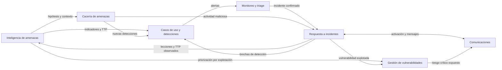

# Digest de conocimiento: gerente

- **CIAC-001 Hub general** — `contrib/ciac-knowledge/cache/01-hub.md` (sha256 7b84a245f7ba)
- **CIAC-007 Procedimientos operativos** — `contrib/ciac-knowledge/cache/standard-operating-procedures/README.md` (sha256 f6d3515191db)
- **CIAC-008 Evaluacion de madurez** — `contrib/ciac-knowledge/cache/maturity-assessment/README.md` (sha256 e0021b088323)
- **CIAC-009 Evaluacion de proveedores** — `contrib/ciac-knowledge/cache/vendor-assessment/README.md` (sha256 b5e8e2d54765)

## 01-hub.md
<div align="center">

# CIAC LATAM Community Hub

**Conocimiento abierto de ciberseguridad hecho por y para Latinoamérica**

[Web](https://landing.ciac.lat) · [Telegram](https://t.me/ciberciac) · [WhatsApp](https://whatsapp.com/channel/0029Va6OjVKA89Mj7w8xde06) · [Cómo contribuir](CONTRIBUTING.md)


</div>

Buenas prácticas, inteligencia de amenazas, cacería de amenazas, detecciones, playbooks de respuesta a incidentes y laboratorios DFIR, adaptados a la realidad de las organizaciones de la región.

## Contenido

| Sección | Qué encontrarás | Marcos de referencia |
|---|---|---|
| [best-practices](best-practices/) | Guías de bastionado, configuración segura, desarrollo seguro con IA y buenas prácticas de NIST y CISA por proceso | CIS Benchmarks, CIS Controls v8.1, NIST CSF 2.0, CISA CPG 2.0, OWASP Top 10 for LLM, NIST AI RMF |
| [threat-intelligence](threat-intelligence/) | Análisis de hipótesis, mapeo ATT&CK, análisis de IOCs, perfiles de amenazas y metodologías OSINT | ACH, MITRE ATT&CK, Modelo de Diamante, escala Almirantazgo, Protocolo de Berkeley |
| [threat-hunting](threat-hunting/) | Frameworks y cacerías documentadas para encontrar lo que evadió las defensas | TaHiTI, MaGMa, PEAK, Hunting Maturity Model |
| [detection-as-code](detection-as-code/) | Reglas y consultas listas para usar y adaptar | Sigma, KQL, XQL, YARA, Suricata |
| [incident-response](incident-response/) | Playbooks para ransomware, phishing, BEC, fuga y brecha de datos | NIST SP 800-61r3, ISO/IEC 27035, leyes de protección de datos de la región |
| [dfir-labs](dfir-labs/) | Laboratorios prácticos de análisis forense y respuesta | Escenarios reproducibles con datos sintéticos |
| [standard-operating-procedures](standard-operating-procedures/) | Procedimientos operativos estándar: monitoreo y triage, casos de uso, inteligencia, vulnerabilidades, cacería, respuesta a incidentes y comunicaciones | NIST SP 800-61r3, NIST SP 800-40r4, NIST SP 800-150, TaHiTI, MaGMa, ISO 22361 |
| [maturity-assessment](maturity-assessment/) | Autoevaluación de madurez de SOC, inteligencia, vulnerabilidades, cacería, respuesta a incidentes y comunicaciones | SOC-CMM, SIM3, CTI-CMM, Hunting Maturity Model, NIST CSF 2.0 |
| [vendor-assessment](vendor-assessment/) | Selección, contratación y supervisión de proveedores de SOC, MSSP y MDR | SOC-CMM, SIM3, ISO/IEC 27001, SOC 2, MITRE ATT&CK Evaluations, NIST CSF 2.0 GV.SC |
| [templates](templates/) | Plantillas de informes y evaluaciones | ISO/IEC 27005, NIST SP 800-30 |

## ¿Por qué un hub para LATAM?

La mayoría del material de referencia está en inglés y pensado para organizaciones con presupuestos y equipos grandes. Este repositorio busca:

- Contenido **en español**, con terminología consistente.
- Ejemplos basados en **amenazas que sí se ven en la región**: troyanos bancarios, phishing que suplanta entidades locales, ransomware contra gobierno, salud y manufactura, fraude BEC en comercio exterior.
- Recomendaciones **aplicables por equipos pequeños**, indicando qué es imprescindible y qué es deseable.
- Referencias a **marcos internacionales**, para que todo sea comparable y auditable.


## README.md
# Procedimientos operativos estándar (SOP)

Plantillas de **procedimientos operativos estándar** para los procesos principales de ciberseguridad. Cada SOP describe **quién hace qué, cuándo, con qué entradas, qué produce y cómo se mide**, para que el trabajo no dependa de personas concretas.

| Código | Procedimiento | Madurez relacionada | Buenas prácticas |
|---|---|---|---|
| [SOP-SOC-01](SOP-SOC-01-monitoreo-y-triage.md) | Monitoreo, triage y escalamiento de alertas | [SOC](../maturity-assessment/soc/) | [NIST/CISA SOC](../best-practices/nist-cisa/soc.md) |
| [SOP-SOC-02](SOP-SOC-02-gestion-de-casos-de-uso.md) | Gestión de casos de uso y detecciones | [SOC](../maturity-assessment/soc/) | [Detection as Code](../detection-as-code/) |
| [SOP-CTI-01](SOP-CTI-01-ciclo-de-inteligencia.md) | Ciclo de inteligencia de amenazas | [CTI](../maturity-assessment/cti/) | [NIST/CISA CTI](../best-practices/nist-cisa/cti.md) |
| [SOP-VUL-01](SOP-VUL-01-gestion-de-vulnerabilidades.md) | Gestión de vulnerabilidades | [Vulnerabilidades](../maturity-assessment/vulnerability-management/) | [NIST/CISA Vulnerabilidades](../best-practices/nist-cisa/vulnerability-management.md) |
| [SOP-TH-01](SOP-TH-01-caceria-de-amenazas.md) | Cacería de amenazas | [Cacería](../maturity-assessment/threat-hunting/) | [Frameworks de cacería](../threat-hunting/) |
| [SOP-IR-01](SOP-IR-01-respuesta-a-incidentes.md) | Respuesta a incidentes | [Respuesta a incidentes](../maturity-assessment/incident-response/) | [Playbooks](../incident-response/) |
| [SOP-COM-01](SOP-COM-01-comunicaciones.md) | Comunicaciones de ciberseguridad y crisis | [Comunicaciones](../maturity-assessment/communications/) | [NIST/CISA Comunicaciones](../best-practices/nist-cisa/communications.md) |

Para crear un SOP nuevo usa la [plantilla](_plantilla-sop.md).

## Cómo se relacionan los procesos



Cada SOP termina con una sección de **traspasos**: qué entrega a otros procesos y qué recibe de ellos.

## Cómo adaptarlos

1. **Roles:** reemplaza los roles genéricos por los cargos reales. En equipos pequeños una persona puede cubrir varios roles; lo importante es que cada responsabilidad tenga un nombre.
2. **Tiempos:** los plazos son **ejemplos**. Ajústalos a tu capacidad, a tus contratos y a tu regulación.

## README.md
# Evaluación de madurez

Herramientas para medir y mejorar la madurez de las capacidades de ciberseguridad, basadas en modelos internacionales y adaptadas a la realidad de las organizaciones latinoamericanas: equipos pequeños, presupuestos limitados y regulación en evolución.

## Dominios

| Dominio | Modelo de referencia principal | Evaluación |
|---|---|---|
| [SOC](soc/) | **SOC-CMM** (Security Operations Center Capability Maturity Model) | 13 criterios |
| [Inteligencia de amenazas](cti/) | **CTI-CMM** (Cyber Threat Intelligence Capability Maturity Model) | 12 criterios |
| [Gestión de vulnerabilidades](vulnerability-management/) | **CIS Control 7**, **NIST SP 800-40r4**, **SSVC** | 11 criterios |
| [Cacería de amenazas](threat-hunting/) | **Hunting Maturity Model**, **TaHiTI**, **PEAK** | 10 criterios |
| [Respuesta a incidentes](incident-response/) | **SIM3** de la Open CSIRT Foundation, **NIST SP 800-61r3** | 13 criterios |
| [Comunicaciones](communications/) | **SIM3** (P-2, H-6), **NIST CSF 2.0** (RS.CO), **ISO 22361** | 12 criterios |

## Cómo usarlo

1. **Lee la [escala y el método](escala-y-metodo.md).** Todos los dominios usan la misma escala de 0 a 4 para poder compararlos.
2. **Copia la [hoja de autoevaluación](plantillas/autoevaluacion.csv)** (se abre en Excel o Google Sheets) y califica cada criterio con evidencia.
3. **Define el nivel objetivo** según el perfil de tu organización (ver abajo). No todo tiene que llegar a 4.
4. **Calcula los resultados** con [`scripts/calcular_madurez.py`](scripts/calcular_madurez.py) o en la hoja de cálculo.
5. **Prioriza las brechas** y arma la [hoja de ruta](plantillas/hoja-de-ruta.md).
6. **Comunica** con el [informe de madurez](plantillas/informe-madurez.md).
7. **Repite** cada 12 meses, o tras un cambio importante o un incidente grave.

## Niveles objetivo sugeridos por perfil

| Perfil | Ejemplo | Objetivo general | Prioridad |
|---|---|---|---|
| **Pequeña** | Pyme, ONG, municipio pequeño; TI de 1 a 3 personas, sin SOC propio | **1–2** | Los criterios marcados 🔴 en cada dominio |
| **Mediana** | Empresa con área de seguridad, SOC tercerizado o propio pequeño | **2–3** | Todos los criterios 🔴 en nivel 3 |
| **Regulada o crítica** | Banca, seguros, energía, telecomunicaciones, salud, gobierno central | **3–4** | Todos los criterios en 3; los regulatorios en 4 |

> Una organización pequeña con un SOC tercerizado también puede usar esta evaluación: califica lo que **exiges y verificas** de tu proveedor. Para seleccionar o supervisar proveedores usa [`vendor-assessment`](../vendor-assessment/).

## Por qué estos modelos

- **SOC-CMM** y **SIM3** son los modelos más usados en el mundo para SOC y equipos de respuesta. SIM3 es la base de la certificación de Trusted Introducer y del enfoque de madurez de ENISA para CSIRT nacionales.
- **CTI-CMM** es un modelo comunitario y neutral respecto a proveedores, inspirado en el C2M2, que mide la inteligencia por el valor que entrega a otras áreas.
- Gestión de vulnerabilidades, cacería y comunicaciones no tienen un modelo único dominante; aquí se combinan las referencias más reconocidas.

## README.md
# Evaluación de proveedores de SOC y MSSP

Herramientas para **seleccionar, contratar y supervisar** proveedores de servicios de seguridad gestionados: SOC tercerizado, MSSP, MDR (detección y respuesta gestionadas) o servicios de respuesta a incidentes. Pensado para organizaciones de Latinoamérica de cualquier tamaño, desde la que contrata su primer SOC hasta la entidad regulada que debe justificar la elección ante su supervisor.

## Contenido

| Archivo | Para qué |
|---|---|
| [cuestionario.md](cuestionario.md) | 48 preguntas en 10 secciones, con evidencia a solicitar, señales de alerta y referencias |
| [plantillas/evaluacion-proveedores-ciac.xlsx](plantillas/evaluacion-proveedores-ciac.xlsx) | **Plantilla Excel lista para usar**: datos del proceso, pesos, cuestionario con calificación de hasta tres proveedores, prueba de concepto y resumen automático con ranking, descalificaciones y gráficos |
| [plantillas/cuestionario.csv](plantillas/cuestionario.csv) | Versión para enviar al proveedor y calificar |
| [plantillas/matriz-comparativa.csv](plantillas/matriz-comparativa.csv) y [pesos.csv](plantillas/pesos.csv) | Comparación ponderada de varias ofertas |
| [plantillas/prueba-de-concepto.md](plantillas/prueba-de-concepto.md) | Plan para probar la detección antes de firmar |
| [plantillas/acuerdo-de-nivel-de-servicio.md](plantillas/acuerdo-de-nivel-de-servicio.md) | Estructura de SLA con tiempos por severidad |
| [plantillas/clausulas-contractuales.md](plantillas/clausulas-contractuales.md) | Lista de verificación de cláusulas clave |
| [plantillas/revision-periodica.md](plantillas/revision-periodica.md) | Revisión trimestral y anual del servicio |
| [scripts/comparar_proveedores.py](scripts/comparar_proveedores.py) | Calcula el ranking ponderado y marca descalificaciones |

## Proceso

```
1. Requisitos  →  2. Preselección  →  3. Cuestionario  →  4. Verificación  →  5. Prueba de   →  6. Decisión  →  7. Contrato  →  8. Supervisión
   internos         (3–5 ofertas)      con evidencias      de evidencias      concepto           ponderada        y SLA          periódica
```

1. **Requisitos internos.** Antes de hablar con proveedores, define qué necesitas: activos y fuentes a monitorear, horario, qué acciones puede tomar el proveedor, regulación aplicable, presupuesto. Usa la [evaluación de madurez](../maturity-assessment/) para saber qué capacidades tienes y cuáles necesitas comprar.
2. **Preselección.** Descarta a quien no cumpla los criterios ⛔ básicos (cobertura 24/7, protección de datos, regulación sectorial).
3. **Cuestionario.** Envía la misma versión a todos y exige evidencia, no solo respuestas.
4. **Verificación.** Revisa certificados, pide demostraciones de la consola y llama a las referencias.
5. **Prueba de concepto.** Para contratos relevantes, mide la detección y el escalamiento con técnicas emuladas.
6. **Decisión.** Ajusta los pesos a tu realidad y calcula el ranking con la matriz.
7. **Contrato y SLA.** Lleva al contrato lo que el proveedor prometió en el cuestionario.
8. **Supervisión.** El servicio se gestiona, no solo se compra: revisión trimestral y reevaluación anual.

## Escala

Igual que la [evaluación de madurez](../maturity-assessment/escala-y-metodo.md):

| Puntaje | Significado para un proveedor |
|---|---|
