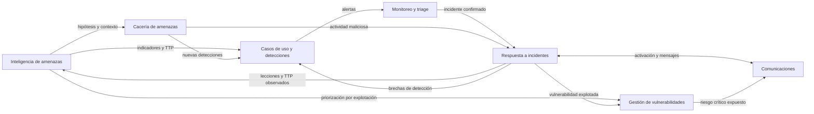

# Digest de conocimiento: runbooks

- **CIAC-005 Respuesta a incidentes** — `contrib/ciac-knowledge/cache/incident-response/README.md` (sha256 f17063a3a9bd)
- **CIAC-007 Procedimientos operativos** — `contrib/ciac-knowledge/cache/standard-operating-procedures/README.md` (sha256 f6d3515191db)
- **CIAC-010 Plantilla de informe** — `contrib/ciac-knowledge/cache/templates/incident-report.md` (sha256 92ffffe779ef)

## README.md
# Respuesta a incidentes

Playbooks para los incidentes más frecuentes en la región, estructurados según el ciclo de **NIST SP 800-61r3** (alineado con NIST CSF 2.0) e **ISO/IEC 27035**.

| Playbook | Cuándo usarlo |
|---|---|
| [ransomware](ransomware/) | Cifrado de archivos, notas de rescate o amenaza de publicación de datos |
| [phishing](phishing/) | Correo malicioso reportado o detectado, con o sin clic |
| [business-email-compromise](business-email-compromise/) | Cuenta de correo comprometida o fraude de pagos por suplantación |
| [data-leak](data-leak/) | Exposición no intencionada de datos: recurso público, credenciales en código, datos publicados por terceros |
| [data-breach](data-breach/) | Acceso no autorizado confirmado a datos, con o sin exfiltración demostrada; incluye notificaciones legales |

## Fases de cada playbook

| Fase | Pregunta clave |
|---|---|
| 0. Preparación | ¿Qué debe existir **antes** del incidente? |
| 1. Detección y análisis | ¿Qué pasó, desde cuándo y qué alcance tiene? |
| 2. Contención | ¿Cómo detengo la propagación sin destruir evidencia? |
| 3. Erradicación | ¿Cómo elimino al atacante y su persistencia? |
| 4. Recuperación | ¿Cómo vuelvo a operar de forma segura? |
| 5. Lecciones aprendidas | ¿Qué cambio para que no se repita? |

## Notificaciones en LATAM
Cada país tiene obligaciones distintas (autoridad de protección de datos, reguladores sectoriales como el financiero, CSIRT nacional). Todo playbook incluye un paso para **verificar con el área legal** qué notificaciones aplican y en qué plazo. Directorio de equipos de respuesta: https://www.first.org/members/teams/

Para documentar el incidente usa [`templates/incident-report.md`](../templates/incident-report.md).

## README.md
# Procedimientos operativos estándar (SOP)

Plantillas de **procedimientos operativos estándar** para los procesos principales de ciberseguridad. Cada SOP describe **quién hace qué, cuándo, con qué entradas, qué produce y cómo se mide**, para que el trabajo no dependa de personas concretas.

| Código | Procedimiento | Madurez relacionada | Buenas prácticas |
|---|---|---|---|
| [SOP-SOC-01](SOP-SOC-01-monitoreo-y-triage.md) | Monitoreo, triage y escalamiento de alertas | [SOC](../maturity-assessment/soc/) | [NIST/CISA SOC](../best-practices/nist-cisa/soc.md) |
| [SOP-SOC-02](SOP-SOC-02-gestion-de-casos-de-uso.md) | Gestión de casos de uso y detecciones | [SOC](../maturity-assessment/soc/) | [Detection as Code](../detection-as-code/) |
| [SOP-CTI-01](SOP-CTI-01-ciclo-de-inteligencia.md) | Ciclo de inteligencia de amenazas | [CTI](../maturity-assessment/cti/) | [NIST/CISA CTI](../best-practices/nist-cisa/cti.md) |
| [SOP-VUL-01](SOP-VUL-01-gestion-de-vulnerabilidades.md) | Gestión de vulnerabilidades | [Vulnerabilidades](../maturity-assessment/vulnerability-management/) | [NIST/CISA Vulnerabilidades](../best-practices/nist-cisa/vulnerability-management.md) |
| [SOP-TH-01](SOP-TH-01-caceria-de-amenazas.md) | Cacería de amenazas | [Cacería](../maturity-assessment/threat-hunting/) | [Frameworks de cacería](../threat-hunting/) |
| [SOP-IR-01](SOP-IR-01-respuesta-a-incidentes.md) | Respuesta a incidentes | [Respuesta a incidentes](../maturity-assessment/incident-response/) | [Playbooks](../incident-response/) |
| [SOP-COM-01](SOP-COM-01-comunicaciones.md) | Comunicaciones de ciberseguridad y crisis | [Comunicaciones](../maturity-assessment/communications/) | [NIST/CISA Comunicaciones](../best-practices/nist-cisa/communications.md) |

Para crear un SOP nuevo usa la [plantilla](_plantilla-sop.md).

## Cómo se relacionan los procesos

Cada SOP termina con una sección de **traspasos**: qué entrega a otros procesos y qué recibe de ellos.

## Cómo adaptarlos

1. **Roles:** reemplaza los roles genéricos por los cargos reales. En equipos pequeños una persona puede cubrir varios roles; lo importante es que cada responsabilidad tenga un nombre.
2. **Tiempos:** los plazos son **ejemplos**. Ajústalos a tu capacidad, a tus contratos y a tu regulación.

## incident-report.md
# Informe de incidente de seguridad

| | |
|---|---|
| **ID del incidente** | INC-AAAA-NNN |
| **Clasificación** | TLP:CLEAR · TLP:GREEN · TLP:AMBER · TLP:RED |
| **Estado** | Abierto · Contenido · Cerrado |
| **Severidad** | Crítica · Alta · Media · Baja |
| **Tipo** | Ransomware · Phishing · BEC · Malware · Acceso no autorizado · Fuga de datos · Otro |
| **Fecha de detección** | AAAA-MM-DD HH:MM (UTC) |
| **Fecha de cierre** | AAAA-MM-DD |
| **Elaborado por** | Nombre · rol |
| **Versión** | 1.0 |

## 1. Resumen ejecutivo
Qué pasó, impacto en el negocio, estado actual y decisiones requeridas. Máximo un párrafo, sin jerga técnica.

## 2. Alcance e impacto

| Dimensión | Detalle |
|---|---|
| Sistemas afectados | |
| Usuarios / cuentas afectadas | |
| Datos comprometidos | Tipo y volumen (personales, financieros, propiedad intelectual) |
| Impacto operativo | Servicios interrumpidos y duración |
| Impacto económico estimado | |

## 3. Línea de tiempo (UTC)

| Fecha y hora | Evento | Fuente de la evidencia |
|---|---|---|
| | Acceso inicial | |
| | Detección | |
| | Contención | |
| | Erradicación | |
| | Recuperación | |

## 4. Análisis técnico
### 4.1 Vector de acceso inicial
### 4.2 Actividad del atacante (ATT&CK)
